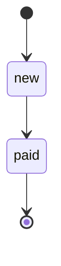

# Домен: сущности, статусы, правила

> Понятия бизнеса, а не таблицы. Таблица хранит сущность, а сущность может жить в нескольких таблицах и сервисах.

## Сущности

### ENT-<имя> — <Название>
status: <draft | planned | implemented>

- meaning: <что это для бизнеса, одно-два предложения>
- identity: <чем однозначно определяется: uuid, номер, пара полей>
- lifecycle: STATE-<…>
- stored in: TBL-<…> (источник правды), копии: <TBL-… в другом сервисе / KV-…>
- owned by: SVC-<…> — только он меняет сущность, остальные читают через API-<…> / EVT-<…>
- invariants: INV-<…>, INV-<…>
- relations: <ENT-<a> 1—N ENT-<b>, ENT-<a> N—1 ENT-<c>>

## Машины состояний

### STATE-<имя> — Статусы <сущности>
status: <…>

| из | в | что вызывает | условие | побочные эффекты |
|---|---|---|---|---|
| `new` | `paid` | EVT-<…> / API-<…> / JOB-<…> | INV-<…> | <публикует EVT-…> |

- terminal: <конечные состояния>
- forbidden: <переходы, которые запрещены явно, и почему>

## Бизнес-правила

### INV-<имя> — <Короткая формулировка>
status: <…>

- statement: <правило одним предложением, без двусмысленности>
- why: <откуда правило: закон, договор, решение бизнеса>
- enforced at: <где проверяется: API-<…>, ограничение в TBL-<…>#<колонка>, CLS-<…>>
- on violation: ERR-<…>
