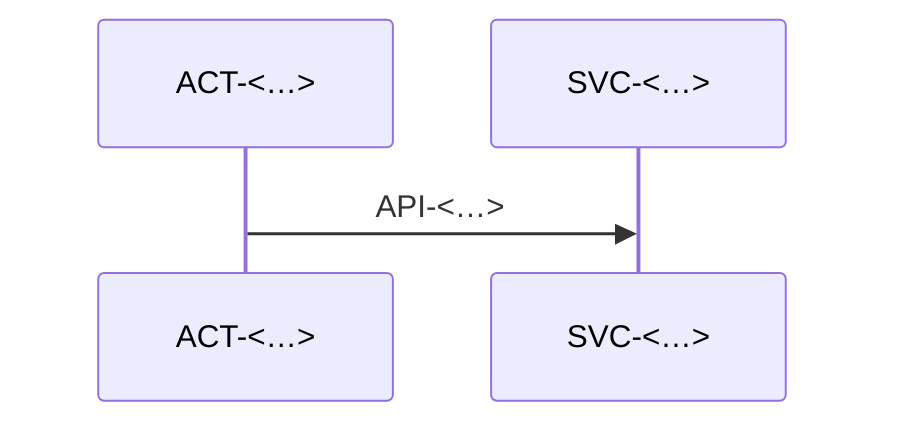

# Сквозные сценарии

> Только сценарии, которые проходят через несколько компонентов или внешних систем.
> Шаги ссылаются на ID — детали в карточках, здесь только порядок.

### FLOW-<имя> — <Название сценария>
status: <…>

- trigger: <что запускает: ACT-<…> вызывает API-<…> / JOB-<…> по расписанию>
- result: <что меняется в системе, когда всё прошло>

1. ACT-<…> → API-<…>: <что происходит>
2. SVC-<…> пишет TBL-<…>, публикует EVT-<…>
3. SVC-<…> получает EVT-<…> → вызывает EXT-<…>

- failures:
  - <на шаге 3 EXT-<…> недоступна> → <ретраи 3 раза с backoff, потом статус STATE-<…>#<…>>
- consistency: <где возможна рассинхронизация и как она исправляется>
