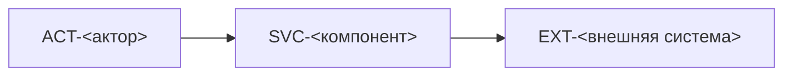

# Обзор системы: контекст

> Кто пользуется системой и с чем она связана снаружи. Внутреннее устройство — в `components/`.

## Контекст (C4, уровень 1)

## Акторы

| id | кто | как взаимодействует | через что | status |
|---|---|---|---|---|
| ACT-<имя> | <клиент / оператор / админ / внешний сервис> | <что делает в системе> | SVC-<…> (API-<…>) | <…> |

## Внешние системы

### EXT-<имя> — <Название>
status: <planned | implemented> | used_by: SVC-<…>

- what: <что это и зачем нам>
- protocol: <HTTPS REST / gRPC / SMTP / SDK `<пакет>` (DEP-<…>)>
- auth: <API-ключ в CFG-<…> / OAuth / mTLS>
- limits: <rate limit, квоты, стоимость за вызов>
- sla / failure: <что делаем, если недоступна: ретраи, очередь, деградация>
- data sent: <какие данные уходят наружу; есть ли PII → SEC-<…>>
- docs: <ссылка на документацию провайдера>
