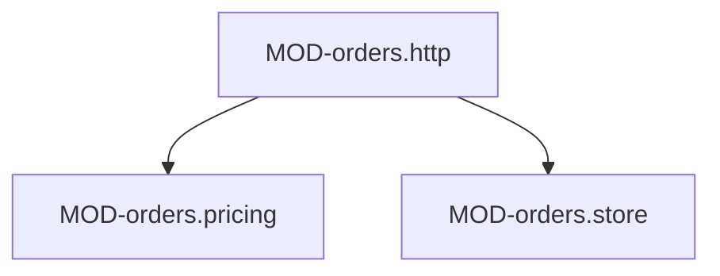

# orders: устройство кода

### MOD-orders.http — HTTP-слой
status: implemented | owner: SVC-orders

- path: `src/orders/internal/http/`
- responsibility: роутинг, JWT, валидация DTO, маппинг ошибок в ERR-*
- depends on: MOD-orders.pricing, MOD-orders.store
- must not: содержать бизнес-правила и SQL

### MOD-orders.pricing — Расчёт суммы
status: implemented | owner: SVC-orders

- path: `src/orders/internal/pricing/`
- responsibility: сумма заказа и проверка INV-order-min-total
- public: CLS-orders.price-calculator
- must not: делать I/O

### MOD-orders.store — Работа с БД
status: implemented | owner: SVC-orders

- path: `src/orders/internal/store/`
- responsibility: чтение и запись TBL-orders, TBL-order-items в одной транзакции

### CLS-orders.price-calculator — Считает сумму заказа
status: implemented | owner: SVC-orders | kind: function

- module: MOD-orders.pricing
- symbol: `Total` в `src/orders/internal/pricing/total.go`
- signature: `Total(items []Item, min decimal.Decimal) (decimal.Decimal, error)`
- guarantees: чистая функция; округление банковское до 2 знаков
- errors: ERR-orders.min-total
