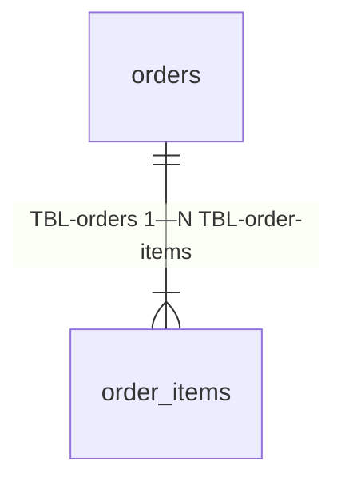

# orders: данные

### TBL-orders — Заказы
status: implemented | owner: SVC-orders | store: RES-pg-main | entity: ENT-order

- purpose: шапка заказа, источник правды о статусе и сумме
- pk: `id`
- retention: 3 года, потом адрес обнуляется (SEC-pii)
- pii: SEC-pii: `delivery_address`

| колонка | тип | null | default | ограничения | смысл |
|---|---|---|---|---|---|
| `id` | uuid | нет | gen | pk | |
| `customer_id` | uuid | нет | | | из JWT, таблицы покупателей у нас нет |
| `status` | enum(STATE-order) | нет | `'new'` | | |
| `total` | decimal(12,2) | нет | | ≥ CFG-ORDERS_MIN_TOTAL на момент создания | INV-order-min-total |
| `delivery_address` | string | нет | | | SEC-pii |
| `idempotency_key` | string | нет | | unique | для API-orders.create |
| `created_at` | timestamp | нет | now() | | |

- indexes:
  - `(customer_id, created_at desc)` — заказы покупателя
  - `(status, created_at)` — поиск неоплаченных для JOB-orders.expire-unpaid
- written by: API-orders.create, JOB-orders.expire-unpaid
- read by: API-orders.get

### TBL-order-items — Позиции заказа
status: implemented | owner: SVC-orders | store: RES-pg-main | entity: ENT-order

| колонка | тип | null | default | ограничения | смысл |
|---|---|---|---|---|---|
| `order_id` | uuid | нет | | fk → TBL-orders#id, on delete cascade | |
| `sku` | string | нет | | | TERM-sku |
| `qty` | int32 | нет | | 1..99 | |
| `unit_price` | decimal(12,2) | нет | | > 0 | |

- pk: `(order_id, sku)`
- written by: API-orders.create; после создания не меняется
