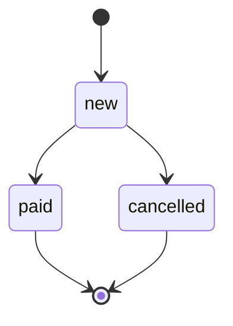

# Домен: сущности, статусы, правила

## Сущности

### ENT-order — Заказ
status: implemented

- meaning: покупка, которую покупатель подтвердил; после создания позиции не меняются
- identity: `uuid`
- lifecycle: STATE-order
- stored in: TBL-orders + TBL-order-items (источник правды)
- owned by: SVC-orders — только он меняет заказ; SVC-recs узнаёт о заказах из EVT-order.created
- invariants: INV-order-not-empty, INV-order-min-total

## Машины состояний

### STATE-order — Статусы заказа
status: implemented

| из | в | что вызывает | условие | побочные эффекты |
|---|---|---|---|---|
| `new` | `paid` | callback от EXT-payments (ещё не реализован, Q-orders.currency) | — | — |
| `new` | `cancelled` | JOB-orders.expire-unpaid | заказ старше 30m | — |

- terminal: `paid`, `cancelled`
- forbidden: `paid → cancelled` — возврат денег делается отдельным процессом, которого пока нет

## Бизнес-правила

### INV-order-not-empty — В заказе есть хотя бы одна позиция
status: implemented

- statement: заказ без позиций создать нельзя
- enforced at: API-orders.create (валидация DTO-order-create)
- on violation: ERR-orders.empty

### INV-order-min-total — Минимальная сумма заказа
status: implemented

- statement: сумма заказа ≥ CFG-ORDERS_MIN_TOTAL (по умолчанию 500.00)
- why: доставка дешевле не окупается — решение бизнеса
- enforced at: CLS-orders.price-calculator
- on violation: ERR-orders.min-total
