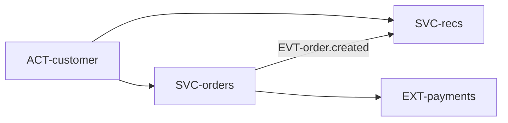

# Обзор системы: контекст

## Акторы

| id | кто | как взаимодействует | через что | status |
|---|---|---|---|---|
| ACT-customer | покупатель (через фронтенд) | оформляет заказ, смотрит рекомендации | API-orders.create, API-recs.for-user | implemented |
| ACT-operator | оператор магазина | пока только через БД, своего API нет | RISK-ops.no-admin-api | implemented |

## Внешние системы

### EXT-payments — Платёжный шлюз
status: planned | used_by: SVC-orders

- what: приём оплаты картой; сейчас заказ создаётся без оплаты, интеграция — следующий этап
- protocol: HTTPS REST
- auth: API-ключ в CFG-PAYMENTS_API_KEY
- limits: 50 rps на магазин
- failure: заказ остаётся в STATE-order#new, JOB-orders.expire-unpaid отменит его
- data sent: сумма и номер заказа; PII не передаём
